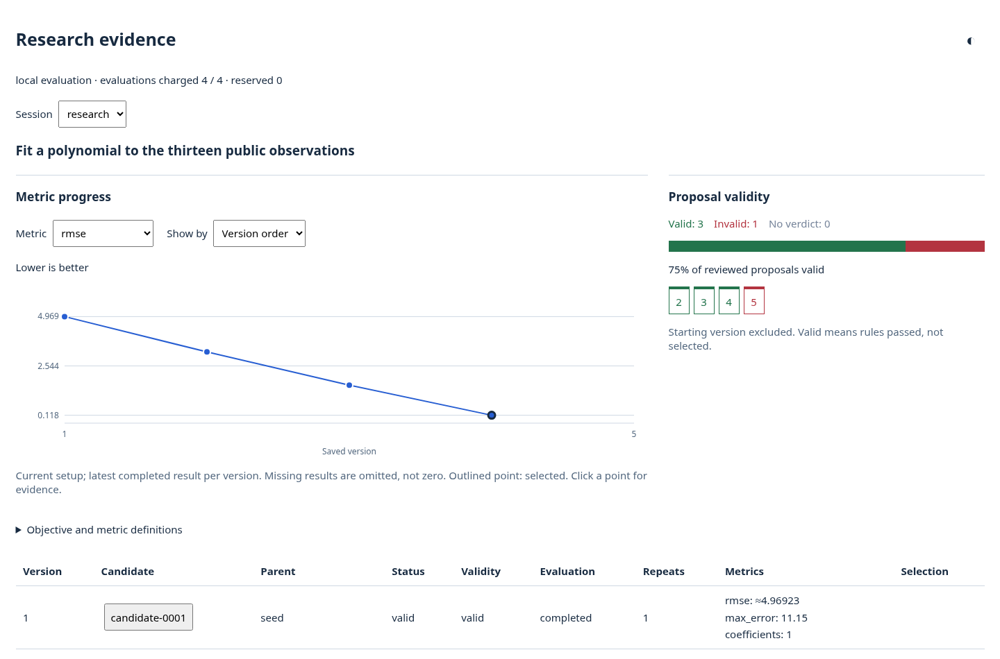

# Autoresearch Infrastructure

Autoresearch Infrastructure (ARI) runs optimization experiments in which an LLM
agent proposes changes and code measures them. You describe the problem once.
ARI saves every proposed version, checks that it follows your rules, evaluates
it, and keeps the best one, all within a budget you set. The agents run through
[Harbor](https://github.com/harbor-framework/harbor), so any Harbor coding agent
can do the work.


## Install

ARI needs Python 3.12 or later, Linux or macOS, and [uv](https://docs.astral.sh/uv/).
Running agents also needs Docker. From the directory containing this README:

```sh
uv venv
source .venv/bin/activate
uv pip install -e '.[harbor]'
```

## A task is a Harbor task

A [Harbor task](https://github.com/harbor-framework/harbor) is a directory with
an instruction, a container and a grader. Most published agent benchmarks ship
their tasks in this format, and its parts are the parts of an ARI task. You
write the problem as a Harbor task, or take one that exists, and add a short
`task.py` beside it.


| Part of the Harbor task | Role in ARI |
| --- | --- |
| `instruction.md` | The written objective the researcher reads. |
| `environment/` | The container the researcher and the reviewer work in, and the starting files. |
| `tests/`, or a grader image | The grader, run on every submission. |
| `task.toml` | Resources and the grader's time limit. |

This is Harbor's format, not Harbor's run. In a Harbor run the test script
executes once, after the agent stops. Here the grader executes after every
submission, in its own container, with ARI between the researcher and the
grader. Harbor still starts the researcher and the reviewer.

A Harbor task written for ARI follows one convention: the deliverable lives in
`/workspace/candidate`. The instruction names that path, the Dockerfile copies
the starting files there from `environment/candidate/`, and the grader reads
it. The researcher edits the same path, so the task reads the same under ARI
and under `harbor run`.

A Harbor task leaves out two things, which `task.py` adds. This is the whole
[threshold-deliverable](examples/threshold-deliverable/task.py) task:

```python
import autoresearch_infrastructure as ari


def task(run):
    return ari.bases.harbor_deliverable(
        run,
        harbor_task="harbor-task",
        feedback="/tests/feedback.sh",      # scored after every submission and shown to the researcher
        sealed="/tests/test.sh",            # scored privately; no agent and no selection step reads it
        rules=[
            "The deliverable is the single file `model.json`.",
            "Choose the threshold from the data in `/app/data/train.csv`.",
        ],
    )
```

- **Two scripts.** Harbor has one test script, which gives the final score.
  Running it on every submission would show the researcher the held-out
  result, so you name a feedback script for that and keep the other sealed.
  `ari sealed <dir>` prints the sealed scores after the run. A task with
  nothing held out passes its one script as `feedback` and `sealed=None`.
- **Rules as a list.** `instruction.md` is one text. The reviewer judges each
  rule separately, so the rules are listed.

A Harbor task from elsewhere, such as a published benchmark task, is used
without editing its files: pass `deliverable=` with the path its instruction
names, such as `/app/output`. The grader sees the candidate at that path, and
the researcher is told to use `/workspace/candidate/` in its place.

`task.py` can also name the metrics when the grader reports several, a
`validity` function for rules that code can decide exactly, and `cases` to
grade every candidate on several fixed inputs. See
[Improve a Harbor task's deliverable](reference.md#improve-a-harbor-tasks-deliverable).

## The three parts of an experiment

| Part | Where it lives | What it holds |
| --- | --- | --- |
| Task | A Harbor task directory and `task.py` | The problem: the objective, the container, the starting files, the grader and the rules. |
| Run settings | `run.toml` | Who works on the task and for how long, in four tables: `[limits]`, `[researcher]`, `[reviewer]` and `[task]`. |
| Run directory | `--output` | Everything a run produces: each saved version, its review, its measurements, the agents' logs and a results page. |

A saved version of the deliverable is called a *candidate*. The unchanged
starting files are the *baseline*. Three kinds of agent can take part:

- The **researcher** reads the instructions, edits the files and submits candidates.
- The **reviewer** judges each candidate against every rule. It reads the same
  instructions as the researcher, so it knows what each rule refers to. Review
  is on by default and uses the researcher's agent unless you name another.
- The **solver** is the agent being evaluated, in tasks that evaluate an agent.

One command opens any task:

```sh
ari check  <task> --output <dir>   # open the task and print its budget; starts nothing
ari record <task> --output <dir>   # save your own edits as a candidate and grade it
ari run    <task> --output <dir>   # grade the baseline, then let researchers propose
ari view   <dir> --html <file>     # export the results as one page
```

`<task>` is a directory containing `task.py`. The settings default to the
`run.toml` beside it; pass `--config` to use another file.

## Run a researcher

The [curve-fitting example](examples/curve-fitting/README.md) fits a polynomial to
thirteen points. Its agents and budget are in [run.toml](examples/curve-fitting/run.toml):

```toml
[limits]             # the baseline plus one proposal
candidates = 2
evaluations = 2

[researcher]         # an ordinary Harbor agent configuration
name = "terminus-2"
model_name = "openrouter/openai/gpt-6-luna"
override_timeout_sec = 300

[reviewer]           # optional: the reviewer defaults to the researcher's agent
name = "terminus-2"
model_name = "openrouter/openai/gpt-6-luna"
override_timeout_sec = 120
```

Choose each agent's harness and model independently. The researcher can be any
Harbor agent that supports MCP servers and writes ATIF trajectories, such as
Codex, Claude Code or Terminus-2. Both agents run in the Harbor task's own
container. When an agent needs something that image lacks, such as `tmux` for
Terminus-2, name an image that adds it under `[task] image`; the
[example](examples/curve-fitting/README.md#run-a-harbor-researcher) shows how.
Set the providers' credentials in the environment. The
[launch guide](skills/use-autoresearch-infrastructure/references/running-autoresearch.md)
covers images and credentials.

```sh
# Validate the task and the settings. Starts and builds nothing.
ari check examples/curve-fitting --output runs/curve

# Run the experiment. This calls your models and costs money.
ari run examples/curve-fitting --output runs/curve
```

`ari run` records and grades the baseline. It then starts a researcher in the
task's container with a copy of the best candidate so far. The researcher edits
the copy and submits it through one tool, `record_candidate`. ARI saves the
submission, has it reviewed, grades it, and returns the result to the
researcher. This repeats until a limit in the settings is reached. Running the
command again continues with whatever budget is left. To go past a finished
run's limits, `ari extend` continues it in a new directory without re-running
anything; see [Extend a finished run](reference.md#extend-a-finished-run).

The limits count candidates and evaluations. Agent starts follow from them: one
review for each candidate and one researcher for each candidate after the
baseline. A failed start still counts. None of this caps tokens or cost, so
also set the turn and token limits your agents support.

To grade your own edits with no agent and no model, use settings without a
researcher: `ari record examples/curve-fitting --config examples/curve-fitting/local.toml --output runs/mine`.
That needs only Docker.

## Set up your own task

A coding agent can set up a task for you. Give it the
[setup skill](skills/use-autoresearch-infrastructure/SKILL.md) and your goal:

```text
Use skills/use-autoresearch-infrastructure/SKILL.md to design an autoresearch
task for <what I want to improve>, using <my files or data>.
Then configure the agents and give me the launch command.
```

The skill has the agent define the objective, the starting files, the grader
and the rules with you, write the Harbor task, `task.py` and `run.toml`, check
them with `ari check`, and report the budget and the launch command. It does
not start a paid run.

What it writes is a Harbor task directory like the one in the figure above:

| You write | Where | Says |
| --- | --- | --- |
| Objective | `instruction.md` | What to change and what should get better. |
| Rules | `rules=[...]` in `task.py` | What a candidate must and must not do. The reviewer judges each rule separately. |
| Starting files | `environment/candidate/` | The unimproved deliverable, copied by the Dockerfile to `/workspace/candidate`. |
| Grader | A script in `tests/` | Reads the deliverable and writes a reward to `/logs/verifier/reward.txt` or `reward.json`. |

ARI lays the instructions out the same way for every task and adds what the
task already knows: the starting files, the metric and its direction,
tie-breakers, bounds, and the number of cases and repeats. The text a
researcher reads therefore cannot disagree with what is measured. Write every
rule down: the researcher has to know a rule to obey it.

## What the researcher sees, and what checks it

The researcher works from four inputs:

| Input | What it holds | Where it comes from |
| --- | --- | --- |
| Objective | What to change and what should get better, with the generated "What is measured" list | `instruction.md`, and the metrics in `task.py` |
| Rules | What a candidate must and must not do | `rules` in `task.py` |
| Environment | The task's container with its files and tools, and the deliverable to edit in `/workspace/candidate/` | The Harbor task's `environment/` |
| Memory | Every earlier candidate: its proposal notes, diff, review and scores | `/history/`, written by ARI |

Two parts check its work. Both are fixed for the run and run outside the
researcher's container:

- The **grader** measures each candidate, and the task's objective ranks
  candidates by those measurements.
- The **monitor** decides whether a candidate is valid: the `validity` function
  first, then the reviewer, which judges each rule the researcher was given.

**Memory.** Each researcher start is a fresh conversation. It sees earlier work
only through the parent candidate's files in `/workspace/candidate/`, through
`/history/`, and through any files it left elsewhere under `/workspace/`.
`/history/` starts with the baseline. After each proposal, ARI adds the
candidate with its proposal notes (hypothesis and mechanism), diff, review,
scores and whatever the grader published. Earlier researchers' own
conversations are not included. A task can change this with `ari.Memory` (fewer
candidates, preloaded records, earlier conversations, or one session that makes
several proposals); see [Researcher inputs](reference.md#researcher-inputs).

**Changing what the researcher is told.** The reviewer judges against the rules
and text the researcher was given, so a run with reworded or omitted rules is
reviewed against those. To judge its candidates against other rules afterwards,
use the saved outputs listed under
[Relabel a finished run](reference.md#relabel-a-finished-run).

## Evaluate an agent on Harbor tasks

Two more base tasks keep the Harbor tasks fixed and change what the solver is
given. Each evaluation is then a Harbor trial of a solver agent, named under
`[task.solver]` in the run settings.

| Base task | What a candidate changes | What stays fixed |
| --- | --- | --- |
| `ari.bases.harbor_task_files` | Files of the Harbor tasks, such as their instructions | The solver agent and the graders |
| `ari.bases.harbor_harness` | The program, prompts, skills and hooks that drive the solver | The Harbor tasks, their graders and the model |

See [Harbor base tasks](reference.md#harbor-base-tasks).

## Without a container: a Python evaluator

The base tasks are built on one lower-level interface, `ari.Task`, whose
`evaluator` is a Python function that ARI calls on the host. Use it directly
when a base task does not fit, or for a small problem where a container would
add nothing. The [packing task](examples/packing/task.py) is the example, and
[Define a task in Python](reference.md#define-a-task-in-python) describes it.
It needs neither Docker nor Harbor. Such an evaluator is trusted code that runs
on your machine, so it must not execute a candidate's files there.

## Examples

Each directory is self-contained: copy one to start your own task.

| Example | What changes | What measures it | Agents |
| --- | --- | --- | --- |
| [Curve fitting](examples/curve-fitting/README.md) | Polynomial coefficients, the deliverable of a Harbor task | The task's grader: error on fixed points, with a plot | Optional researcher and reviewer |
| [Packing](examples/packing/task.py) | Which items to pack | A Python function: value under a weight limit | None; a scripted demo |
| [Threshold deliverable](examples/threshold-deliverable/README.md) | The deliverable of a Harbor task | The task's grader, with a feedback split and a sealed split | Optional researcher and reviewer |
| [Sum instructions](examples/sum-instructions/README.md) | The instructions of a Harbor task | The task's grader, with a fixed solver | Researcher, reviewer and solver |
| [Sum harness](examples/sum-harness/README.md) | The program and prompt that drive a solver | The grader of a fixed Harbor task | Researcher, reviewer and solver |

The [harness programs](examples/harness-programs/README.md) are three sample solver
programs to start a harness task from. The [task bank](examples/task-bank/README.md)
holds longer studies on public benchmarks, with their recorded results.

## Inspect results

A run directory contains:

```text
plan.json      the task and settings the run was opened with
starts.json    the agent starts used so far
context/       read-only material the researcher was given
research/      every candidate: its files, diff, review and measurements
summary.json   the outcome of the last run
viewer.html    the results as one page
```

The page charts each metric by candidate and shows how many proposals were
valid. Select a candidate to see its files, its diff from its parent, the
review, the measurements, and the agents' own trajectories.

Integrations can register any validated Harbor `Trajectory` with
`publish_atif`, then serve its jobs directory through
`create_harbor_viewer_app`. The helper uses Harbor's packaged interface and
allowlists only its finished-job read routes.

<details>
<summary>The results page for the curve-fitting demo</summary>



</details>

## Further reading

- [Reference](reference.md): the task and settings fields, the Python API, and what ARI isolates.
- [Programmatic use](docs/programmatic.md): the scripted demos, which need no agents, and driving an experiment from your own Python.
- [Setup skill](skills/use-autoresearch-infrastructure/SKILL.md): instructions for a coding agent that sets up a task.
- [Importing a task](skills/use-autoresearch-infrastructure/references/importing-tasks.md): three published benchmark tasks broken down into ARI's parts.
- [Launch guide](skills/use-autoresearch-infrastructure/references/running-autoresearch.md): agent configuration, images and credentials.
