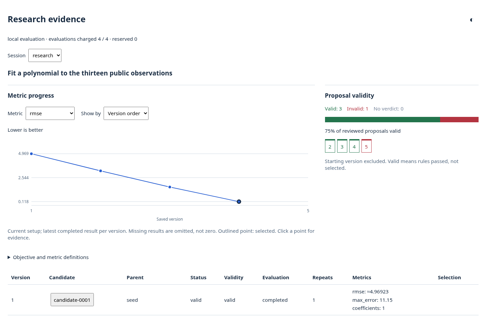

# Autoresearch Infrastructure

Autoresearch Infrastructure (ARI) runs optimization experiments in which an LLM
agent proposes changes and code measures them. You describe the problem once.
ARI saves every proposed version, checks that it follows your rules, evaluates
it, and keeps the best one, all within a budget you set. The agents run through
[Harbor](https://github.com/harbor-framework/harbor), so any Harbor coding agent
can do the work.


## Install

ARI needs Python 3.12 or later, Linux or macOS, and [uv](https://docs.astral.sh/uv/).
Running agents also needs Docker. From the directory containing this README:

```sh
uv venv
source .venv/bin/activate
uv pip install -e '.[harbor]'
```

## The three parts of an experiment


| Part | Where it lives | What it holds |
| --- | --- | --- |
| Task | `task.py` | The problem, in four parts: the starting files (`seed`), what the researcher is told, including the rules (`instructions`), the metric to improve (`objective`), and the code that measures a version (`evaluator`). |
| Run settings | `run.toml` | Who works on the task and for how long, in four tables: `[limits]`, `[researcher]`, `[reviewer]` and `[task]`. |
| Run directory | `--output` | Everything a run produces: each saved version, its review, its measurements, the agents' logs and a results page. |

A saved version of the editable files is called a *candidate*. The unchanged
starting files are the *baseline*. Three kinds of agent can take part:

- The **researcher** reads the instructions, edits the files and submits candidates.
- The **reviewer** judges each candidate against every rule in the instructions. Review
  is on by default and uses the researcher's agent unless you name another.
- The **solver** is the agent being evaluated, in tasks that evaluate an agent.

One command opens any task:

```sh
ari check  <task> --output <dir>   # open the task and print its budget; starts nothing
ari record <task> --output <dir>   # save your own edits as a candidate and evaluate it
ari run    <task> --output <dir>   # measure the baseline, then let researchers propose
ari view   <dir> --html <file>     # export the results as one page
```

`<task>` is a directory containing `task.py`. The settings default to the
`run.toml` beside it; pass `--config` to use another file. When the settings name
a researcher or reviewer, pass their container image with `--image`.

## Run a researcher

The [curve-fitting example](examples/curve-fitting/README.md) fits a polynomial to
thirteen points. Its agents and budget are in [run.toml](examples/curve-fitting/run.toml):

```toml
[limits]             # the baseline plus one proposal
candidates = 2
evaluations = 2

[researcher]         # an ordinary Harbor agent configuration
name = "terminus-2"
model_name = "openrouter/openai/gpt-6-luna"
override_timeout_sec = 300

[reviewer]           # optional: the reviewer defaults to the researcher's agent
name = "terminus-2"
model_name = "openrouter/openai/gpt-6-luna"
override_timeout_sec = 120
```

Choose each agent's harness and model independently. The researcher can be any
Harbor agent that supports MCP servers and writes ATIF trajectories, such as
Codex, Claude Code or Terminus-2. Build one container image with what your
chosen agents need, set their provider credentials in the environment, and pass
the image's ID. The [launch guide](skills/use-autoresearch-infrastructure/references/running-autoresearch.md)
covers images and credentials.

```sh
# Validate the task, the settings and the image reference. Starts nothing.
ari check examples/curve-fitting --image <image-id> --output runs/curve

# Run the experiment. This calls your models and costs money.
ari run examples/curve-fitting --image <image-id> --output runs/curve
```

`ari run` records and measures the baseline. It then starts a researcher in a
container holding a copy of the best candidate so far. The researcher edits the
copy and submits it through one tool, `record_candidate`. ARI saves the
submission, has it reviewed, evaluates it, and returns the result to the
researcher. This repeats until a limit in the settings is reached. Running the
command again continues with whatever budget is left.

The limits count candidates and evaluations. Agent starts follow from them: one
review for each candidate and one researcher for each candidate after the
baseline. A failed start still counts. None of this caps tokens or cost, so
also set the turn and token limits your agents support.

## Set up your own task

A coding agent can set up a task for you. Give it the
[setup skill](skills/use-autoresearch-infrastructure/SKILL.md) and your goal:

```text
Use skills/use-autoresearch-infrastructure/SKILL.md to design an autoresearch
task for <what I want to improve>, using <my files or data>.
Then configure the agents and give me the launch command.
```

The skill has the agent define the objective, the starting files, the evaluator
and the rules with you, write `task.py` and `run.toml`, check them with
`ari check`, and report the budget and the launch command. It does not start a
paid run.

What it writes is small. A task file defines one function. This is the
[packing task](examples/packing/task.py), shortened:

```python
import json
from pathlib import Path

import autoresearch_infrastructure as ari

CATALOG = {"map": (2, 3), "water": (3, 6), "book": (4, 4), "food": (2, 5)}  # name: (weight, value)
VALUE = ari.Metric("value")
WEIGHT = ari.Metric("weight", "min", maximum=7)


def evaluate(candidate, context):
    names = json.loads((candidate / "items.json").read_text())
    return ari.Evaluation({
        VALUE: sum(CATALOG[name][1] for name in names),
        WEIGHT: sum(CATALOG[name][0] for name in names),
    })


def task(run):
    return ari.Task(
        instructions=ari.Instructions(
            objective="Improve items.json, a list of catalog item names, so the packed items are worth more.",
            rules=["List each item at most once.", "Use only names from the catalog."],
        ),
        objective=ari.Objective(VALUE, tie_breakers=(WEIGHT,)),
        evaluator=evaluate,
    )
```

Paths in a task are relative to the task file. The starting files default to the
`seed/` directory beside it, and the instructions to `instructions.md` there, so
a task that follows that layout names neither.

`instructions` has a fixed layout. You write three things, in Python as above or
as Markdown like [the curve-fitting instructions](examples/curve-fitting/instructions.md):

| You write | Says |
| --- | --- |
| Objective | What to change and what should get better. |
| Constraints: Rules | What a candidate must and must not do. The reviewer judges each rule separately. |
| Constraints: Environment | What the sandbox enforces whatever the researcher does. |

ARI lays these out the same way for every task and adds what the task already
knows: the starting files, the metric and its direction, tie-breakers, bounds,
and the number of cases and repeats. The text a researcher reads therefore
cannot disagree with what is measured. Write every rule down: the researcher
has to know a rule to obey it. Three
optional parts refine a task: a `validity` function for rules that code can
decide exactly, `cases` to evaluate on several fixed inputs, and `context` files
for the researcher to read.

## Build on a Harbor task

Most agent experiments evaluate on Harbor tasks. ARI has two tasks to build on,
so a new one is a few lines.

| Base task | What a candidate changes | What stays fixed |
| --- | --- | --- |
| `ari.bases.harbor_task_files` | Files of the Harbor tasks, such as their instructions | The solver agent and the graders |
| `ari.bases.harbor_harness` | The program, prompts, skills and hooks that drive the solver | The Harbor tasks, their graders and the model |

This is the whole [sum-harness](examples/sum-harness/task.py) task:

```python
import autoresearch_infrastructure as ari


def task(run):
    return ari.bases.harbor_harness(
        run,
        harbor_tasks={"sum": "harbor-task"},
        advice="Do not hard-code the input numbers or the expected total.",
    )
```

Point `harbor_tasks` at your own Harbor task directories, one entry for each, and
name the solver under `[task.solver]` in the run settings. Each Harbor task's own
grader scores the trials.

## Examples

Each directory is self-contained: copy one to start your own task.

| Example | What changes | What measures it | Agents |
| --- | --- | --- | --- |
| [Curve fitting](examples/curve-fitting/README.md) | Polynomial coefficients | A Python function: error on fixed points | Optional researcher and reviewer |
| [Packing](examples/packing/task.py) | Which items to pack | A Python function: value under a weight limit | None; a scripted demo |
| [Sum instructions](examples/sum-instructions/README.md) | The instructions of a Harbor task | The task's grader, with a fixed solver | Researcher, reviewer and solver |
| [Sum harness](examples/sum-harness/README.md) | The program and prompt that drive a solver | The grader of a fixed Harbor task | Researcher, reviewer and solver |

The [harness programs](examples/harness-programs/README.md) are three sample solver
programs to start a harness task from. The [task bank](examples/task-bank/README.md)
holds longer studies on public benchmarks, with their recorded results.

## Inspect results

A run directory contains:

```text
plan.json      the task and settings the run was opened with
starts.json    the agent starts used so far
context/       read-only material the researcher was given
research/      every candidate: its files, diff, review and measurements
summary.json   the outcome of the last run
viewer.html    the results as one page
```

The page charts each metric by candidate and shows how many proposals were
valid. Select a candidate to see its files, its diff from its parent, the
review, the measurements, and the agents' own trajectories.

<details>
<summary>The results page for the curve-fitting demo</summary>



</details>

## Further reading

- [Reference](reference.md): the task and settings fields, the Python API, and what ARI isolates.
- [Programmatic use](docs/programmatic.md): the scripted demos, which need no agents or Docker, and driving an experiment from your own Python.
- [Setup skill](skills/use-autoresearch-infrastructure/SKILL.md): instructions for a coding agent that sets up a task.
- [Importing a task](skills/use-autoresearch-infrastructure/references/importing-tasks.md): three published benchmark tasks broken down into ARI's parts.
- [Launch guide](skills/use-autoresearch-infrastructure/references/running-autoresearch.md): agent configuration, images and credentials.
