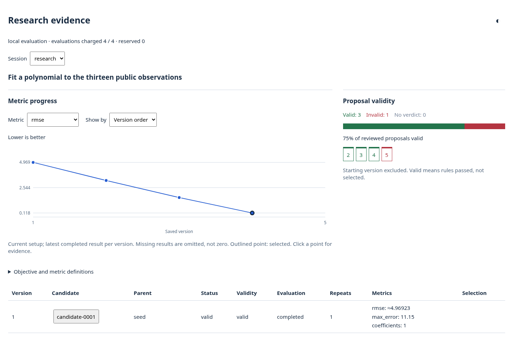
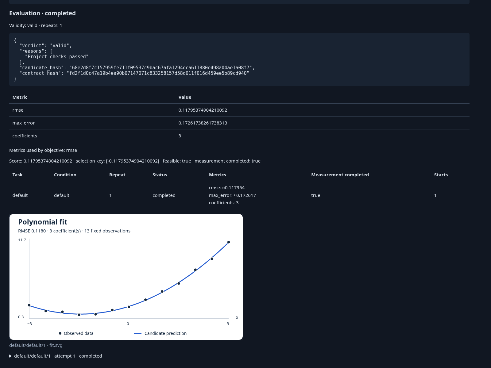
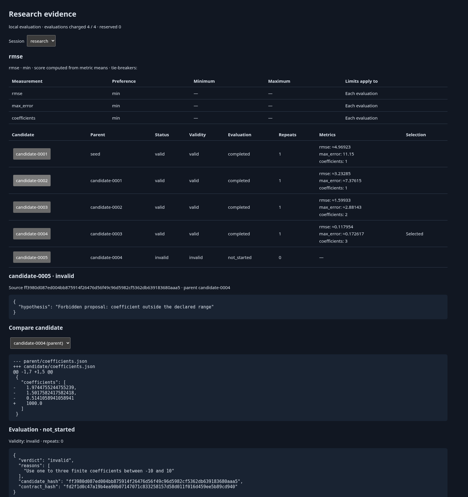

# Programmatic use

Use the Python API when you want to write the proposal loop yourself, evaluate
edits you make by hand, or embed an experiment in another program. None of this
needs agents, Docker or Harbor. To have an LLM researcher propose changes, start
with the [README](../README.md).

The core needs Python 3.12 or later and has no third-party dependencies. Install
it from the package directory with `uv pip install -e .`, and run the commands
below from that directory.

## Try the curve-fitting example without agents

The [curve-fitting task](../examples/curve-fitting/README.md) fits
`y = c0 + c1*x + c2*x²` to thirteen fixed, noisy observations. A candidate is one
file, `coefficients.json`. The objective is root mean squared error (RMSE), which
is minimized. Maximum error and coefficient count are also recorded.

A script makes five proposals in place of a researcher:

```sh
python examples/curve-fitting/demo.py --output ../ari-runs/curve
```

```text
candidate-0001 valid completed {'rmse': 4.97, 'max_error': 11.15, 'coefficients': 1.0}
candidate-0002 valid completed {'rmse': 3.23, 'max_error': 7.38, 'coefficients': 1.0}
candidate-0003 valid completed {'rmse': 1.6, 'max_error': 2.88, 'coefficients': 2.0}
candidate-0004 valid completed {'rmse': 0.12, 'max_error': 0.17, 'coefficients': 3.0}
candidate-0005 invalid not_started ['Use one to three finite coefficients between -10 and 10']
Selected: candidate-0004
```

The script records a baseline that predicts zero, then least-squares constant,
linear and quadratic fits, then a coefficient outside the allowed range. The
task's validity function rejects the last one, so it is saved and not evaluated. The output
directory must be new.

This is fixture evidence. It shows that recording, checking, evaluating and
selecting work. The error is measured on the same observations the coefficients
were fitted to, so it says nothing about held-out data.

To make your own proposals, open a run, edit the workspace it prints, and record
each edit:

```sh
ari check examples/curve-fitting --config examples/curve-fitting/local.toml --output ../ari-runs/manual
ari record examples/curve-fitting --config examples/curve-fitting/local.toml --output ../ari-runs/manual
```

`ari check` creates the run directory and starts nothing. Each `ari record` saves
the workspace as the next candidate, so the first one records the baseline.
[local.toml](../examples/curve-fitting/local.toml) names no agents, turns review
off with `reviewer = false`, and allows five candidates and four evaluations.
The task's validity function alone decides validity.

## View the results

The demo and `ari record` write `viewer.html` in the run directory. To export the
page elsewhere, run `ari view ../ari-runs/curve --html ../ari-runs/curve.html`.

The screenshots below come from a run of the scripted demo. The first chart shows
a metric for each candidate. The validity panel counts proposals and leaves out
the baseline. A candidate with no completed measurement is left out of the chart
and is never drawn as zero.



<details>
<summary>One candidate's evaluation, and the candidate table</summary>

An evaluator can save images, such as the fitted curve below. The page shows them
beside that evaluation's metrics.



Every candidate has its parent, verdict, metrics and a diff from its parent. The
invalid proposal shows the reason the validity function gave.



</details>

## Write your own proposal loop

`open_run` loads a task and its run settings and returns the open experiment as
`run.research`. Your code edits `research.workspace` and calls
`record_candidate`. ARI saves the files, runs the task's validity function, evaluates the
candidate and updates the selected candidate. The settings file is required. One
that names no agents must say `reviewer = false`, as `local.toml` does.

```python
import json
from pathlib import Path

from autoresearch_infrastructure.launch import open_run

task = Path("examples/curve-fitting")
run = open_run(task, task / "local.toml", Path("../ari-runs/loop"), image=None)

with run.research as research:
    research.record_candidate(proposal={"hypothesis": "Unchanged starting files"})
    for slope in (0.5, 1.0, 1.5):
        parent = research.selected
        research.reset_workspace(parent)
        coefficients = {"coefficients": [3.0, slope]}
        (research.workspace / "coefficients.json").write_text(json.dumps(coefficients))
        result = research.record_candidate(parent_id=parent, proposal={"hypothesis": f"Slope {slope}"})
        print(result["candidate_id"], result["status"], result["evidence"]["metrics"])
    print("Selected:", research.selected)
    run.save(run.summary("completed"))
```

Each pass starts from the selected candidate, which is the best valid candidate
so far. `run.save` writes `summary.json` and `viewer.html`. The settings allow
four evaluations, so this loop uses the whole budget.

Without a task file, construct `ari.Research` directly. The
[reference](../reference.md#define-a-small-experiment) has a complete example.

## Embed an experiment in another program

- Use `Research` as a context manager, or call `close()`. One process writes an
  output at a time.
- Define the evaluator and the validity function in a `.py` module. ARI hashes their source
  file to detect a changed setup.
- Call `research.check_metrics(...)` to test the objective on sample values, and
  `research.budget_summary()` to read what is left. Neither starts anything.
- Reopening the same output with the same setup resumes it. A changed setup needs
  a new output.
- `Research` prints nothing. Pass `progress=` to show status lines, as described
  under [Human terminal progress](../reference.md#human-terminal-progress).
- To start a Harbor researcher from your own loop, see
  [The researcher step](../reference.md#the-researcher-step).
